| | |
|---|---|
| **NamaCart** | [nc-landing](https://github.com/namacart/nc-landing) · [namacart-web](https://github.com/chanakya-bugata/namacart-web) · `pii` *(private, investment intelligence)* |
| **Mobile** | [Radiance](https://github.com/chanakya-bugata/Radiance) · [Radiance-App](https://github.com/chanakya-bugata/Radiance-App) · [Library Management (Swift)](https://github.com/chanakya-bugata/LibraryManagementSystem) |
| **AI / ML** | [legal_ai_assist](https://github.com/chanakya-bugata/legal_ai_assist) · [pothole_detection](https://github.com/chanakya-bugata/pothole_detection) · [chatbot](https://github.com/chanakya-bugata/chatbot) · [crop_recommendation_system](https://github.com/chanakya-bugata/crop_recommendation_system) |
| **Web &amp; APIs** | [chanakya-portfolio](https://github.com/chanakya-bugata/chanakya-portfolio) · [doctor-search](https://github.com/chanakya-bugata/doctor-search) · [labtest-api](https://github.com/chanakya-bugata/labtest-api) · [VoiceBridge](https://github.com/chanakya-bugata/VoiceBridge) |

<picture>
  <source media="(prefers-color-scheme: dark)" srcset="https://raw.githubusercontent.com/chanakya-bugata/chanakya-bugata/output/github-snake-dark.svg" />
  <source media="(prefers-color-scheme: light)" srcset="https://raw.githubusercontent.com/chanakya-bugata/chanakya-bugata/output/github-snake.svg" />
  
</picture>

<a href="mailto:chanakya.offc@gmail.com"><b>chanakya.offc@gmail.com</b></a>

