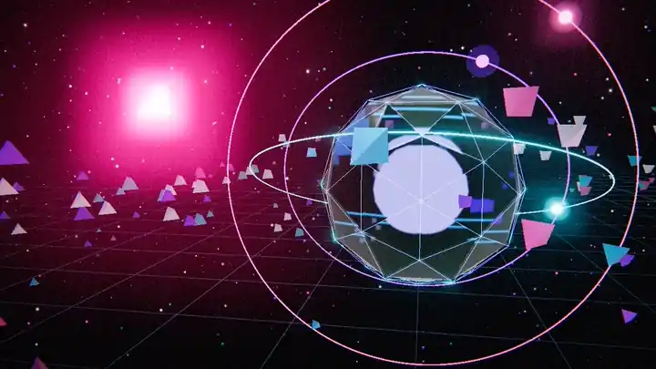

<a href="https://chanakya-bugata.github.io/chanakya-bugata/"><b>Open the interactive 3D portfolio — scroll to explore</b></a>

The same reel, as plain text

**A normal day:** analyse, design, build, test, ship, monitor.

**What I offer:** web apps and dashboards, mobile apps, AI and smart features, APIs and backends, data and analysis, automation and quality.

**Toolbelt:** TypeScript, React, Node.js, Python, Swift, Java, Spring Boot, SQL, PostgreSQL, Docker, GitHub Actions, Jenkins, Selenium, Cloudflare, LLMs, computer vision.

<picture>
  <source media="(prefers-color-scheme: dark)" srcset="https://raw.githubusercontent.com/chanakya-bugata/chanakya-bugata/output/github-snake-dark.svg" />
  <source media="(prefers-color-scheme: light)" srcset="https://raw.githubusercontent.com/chanakya-bugata/chanakya-bugata/output/github-snake.svg" />
  
</picture>

